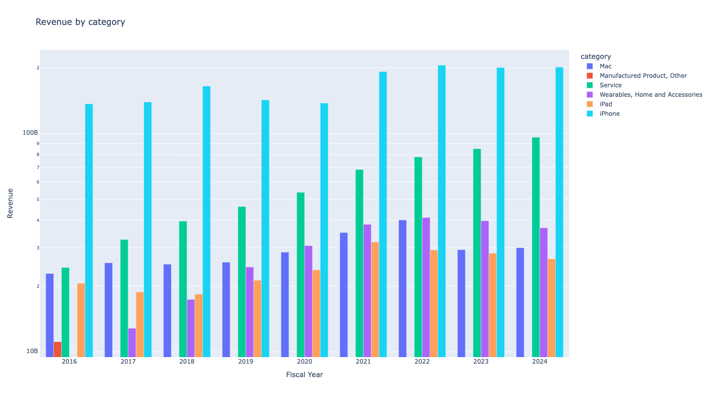
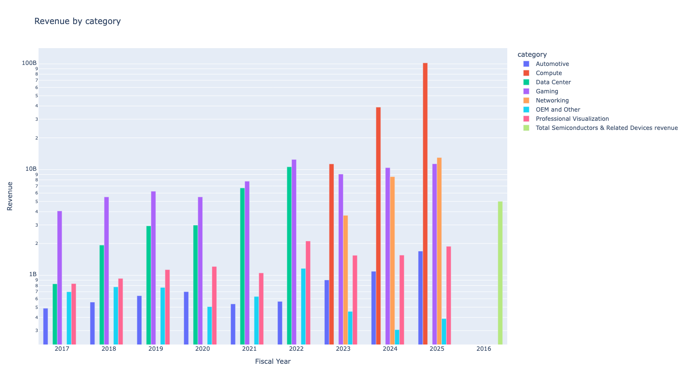

Finviz Plots
============

Grouped bar charts of revenue broken down by product, segment or region,
from Finviz. Each takes ``logarithmic`` (bool) to use a log scale on the
y-axis, which helps when one category is much larger than the rest.

Revenue by Products and Services
--------------------------------

.. code-block:: python

    from stockdex import Ticker

    ticker = Ticker(ticker="AAPL")
    ticker.plot_finviz_revenue_by_products_and_services(logarithmic=False)

Revenue by Segments
-------------------

.. code-block:: python

    from stockdex import Ticker

    ticker = Ticker(ticker="AAPL")
    ticker.plot_finviz_revenue_by_segments(logarithmic=False)

Revenue by Regions
------------------

.. code-block:: python

    from stockdex import Ticker

    ticker = Ticker(ticker="NVDA")
    ticker.plot_finviz_revenue_by_regions(logarithmic=True)

